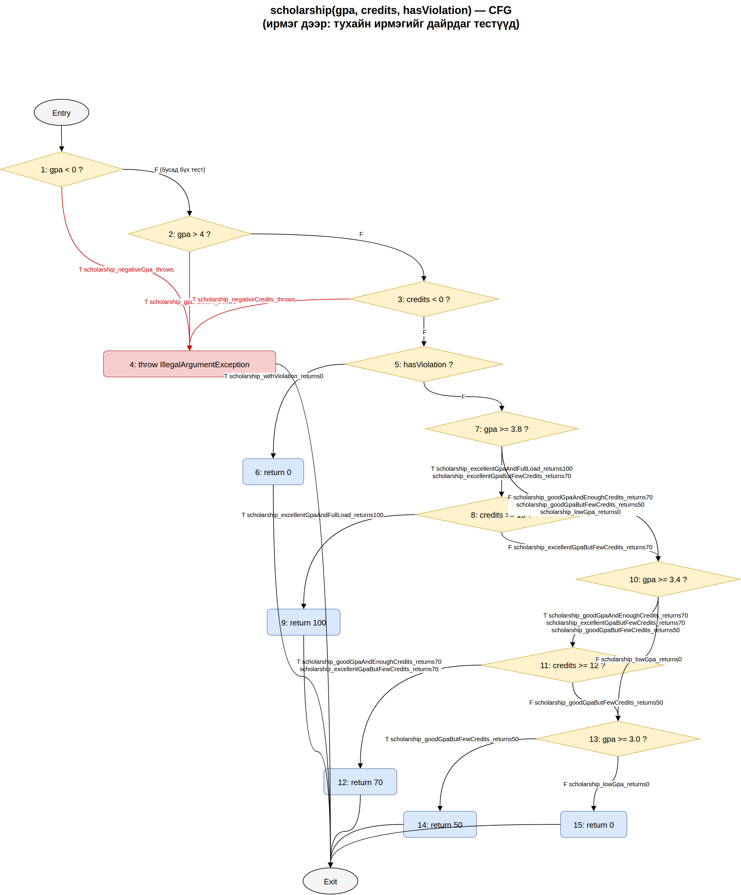

# Лаборатори №9: Код хамралт — JaCoCo

**F.CSA313 — Программ хангамжийн чанарын баталгаа ба тест (2026)**

- **Оюутны нэр:** Э.Бүрэнбаяр
- **Оюутны код:** B242270084

## Орчин

~~~
$ java -version
openjdk version "21.0.12.1" 2026-08-18
OpenJDK Runtime Environment (build 21.0.12.1+1-1-24.04.4-Ubuntu)
OpenJDK 64-Bit Server VM (build 21.0.12.1+1-1-24.04.4-Ubuntu, mixed mode, sharing)

$ mvn -version
Apache Maven 3.8.7
Maven home: /usr/share/maven
Java version: 21.0.12.1, vendor: Ubuntu, runtime: /usr/lib/jvm/java-21-openjdk-amd64
Default locale: en_US, platform encoding: UTF-8
OS name: "linux", version: "7.0.0-42-generic", arch: "amd64", family: "unix"
~~~

## Төслийн бүтэц

~~~
lab09-jacoco/
├── pom.xml
├── README.md
├── cfg.png
├── results/
│   ├── mvn-verify-A.txt
│   ├── jacoco-A.csv
│   ├── mvn-verify-B.txt
│   ├── jacoco-B.csv
│   ├── mvn-test-D-fail.txt
│   ├── mvn-verify-final.txt
│   └── jacoco-final.csv
└── src/
    ├── main/java/mn/edu/must/sqat/ScholarshipCalculator.java
    └── test/java/mn/edu/must/sqat/ScholarshipCalculatorTest.java
~~~

`pom.xml`-д `maven-compiler-plugin` 3.13.0-г тодорхой зааж өгсөн: Ubuntu-ийн `apt`-ийн Maven (3.8.7)
анхдагчаар compiler-plugin 3.1 ашигладаг бөгөөд тэр нь `maven.compiler.release=17`-г ойлгодоггүй тул
"Source option 5 is no longer supported" алдаа өгч байсан.

## Хэсэг A: Happy path ба эхний хэмжилт

5 тест (`letterGrade(95)="A"`, `letterGrade(85)="B"`, `gpa([95,85])=3.5`,
`scholarship(3.9,16,false)=100`, `scholarship(3.5,13,false)=70`) →
[`results/mvn-verify-A.txt`](results/mvn-verify-A.txt): **Tests run: 5**, BUILD SUCCESS.

[`results/jacoco-A.csv`](results/jacoco-A.csv)-аас:

| Хэмжүүр | Covered | Missed | Хамралт |
|---------|---------|--------|---------|
| Branch  | 20 | 21 | 20/41 = **48.8%** |
| Line    | 15 | 10 | 15/25 = **60.0%** |

**Ажиглалт.** Шар ромботой (хагас хамрагдсан) мөрүүд нь голдуу оролт шалгах нөхцлүүд
(`score < 0 || score > 100`, `scores == null || scores.length == 0`, `gpa < 0 || gpa > 4 || credits < 0`)
бөгөөд happy path тестүүд зөвхөн тэдгээрийн "зөв оролт" (F) салааг дайрсан; мөн `switch`-д зөвхөн
A, B тохиолдол, `&&` нөхцлүүдэд зөвхөн нэг талын утга шалгагдсан. Улаан (огт хүрээгүй) мөрүүд нь
бүх `throw` мөр буюу алдааны замууд, C/D/F үсгэн дүн, 50% ба 0% тэтгэлгийн буцаалтууд байсан —
өөрөөр хэлбэл happy path тест алдааны болон "муу" тохиолдлуудыг огт шалгадаггүй.

## Хэсэг B: CFG ба branch 100%

[`cfg.png`](cfg.png) — `scholarship()`-ийн CFG (гараар зурсан): 4 оролтын шалгалт + 6 буцаалтын
зангилаа; ирмэг бүрийн хажууд түүнийг дайрч буй тестийн метод нэр бичигдсэн. Хэсэг A-гийн дараа
хамрагдаагүй ирмэгүүд (гурван `throw` ирмэг, `hasViolation = T`, `credits >= 15 = F`,
`credits >= 12 = F`, `gpa >= 3.4 = F`, `gpa >= 3.0 = T/F`) шинэ тестийн жагсаалт болсон.

Нэмсэн 15 тест:
- `letterGrade`: C (75), D (65), F (50), `-1` ба `101`-д `assertThrows`.
- `gpa`: A/B/C/D/F бүгдийг агуулсан массив (`switch`-ийн `default` салаа), `null` ба хоосон массивт `assertThrows`.
- `scholarship`: `||` нөхцөл бүрийн үнэн утганд тусдаа гурван `assertThrows` (`gpa=-0.1`, `gpa=4.1`, `credits=-1`),
  зөрчилтэй (0), голч хангасан ч кредит дутуу (`3.9,13 → 70`, `3.5,10 → 50`), бага голч (`2.5,20 → 0`).

Нийт **20 тест** шаардагдсан ([`results/mvn-verify-B.txt`](results/mvn-verify-B.txt): Tests run: 20, BUILD SUCCESS).
[`results/jacoco-B.csv`](results/jacoco-B.csv): Branch 41/41, Line 25/25 — **BRANCH_MISSED = 0, LINE_MISSED = 0**.

## Хэсэг C: Давталтын заагийн тестүүд

| Давталт | Тест | Шалгалт |
|---------|------|---------|
| 0 удаа  | `gpa_loopZeroIterations_nullAndEmpty_throw` | хоосон массив ба `null` → `assertThrows(IllegalArgumentException)` |
| 1 удаа  | `gpa_loopOneIteration_singleA_returns4` | `gpa([95]) == 4.0` |
| 2+ удаа | `gpa_loopManyIterations_fourScores_returns2_5` | `gpa([95, 85, 75, 65]) == 2.5` |

Хамралт аль хэдийн 100% байсан тул эдгээр тест тоог өсгөөгүй (23 тест, BUILD SUCCESS). Гэхдээ
хамралт зөвхөн "давталтын бие ядаж нэг удаа ажилласан уу" гэдгийг хэмждэг — давталтын тоолуур,
хуваах үйлдлийн хуваагч (`scores.length`), анхны утга (`total = 0`) зэрэгт гардаг алдаа зөвхөн
0 / 1 / олон удаагийн зааг тохиолдолд л илэрдэг тул эдгээр тест хэрэгтэй хэвээр.

## Хэсэг D: Хамралт 100% — гэхдээ алдаа амьд

Спецификацийн дагуу 7 зааг утгын тест (`@ParameterizedTest` + `@CsvSource`):
`60→D`, `59.99→F`, `69.99→D`, `0→F`, `100→A`, `89.99→B`, `90→A`.

[`results/mvn-test-D-fail.txt`](results/mvn-test-D-fail.txt) — **Tests run: 30, Failures: 1**, BUILD FAILURE:

~~~
[ERROR] mn.edu.must.sqat.ScholarshipCalculatorTest.letterGrade_boundaryScores_matchSpec(double, String)[1] -- Time elapsed: 0.028 s <<< FAILURE!
org.opentest4j.AssertionFailedError: expected: <D> but was: <F>
[ERROR]   ScholarshipCalculatorTest.letterGrade_boundaryScores_matchSpec:151 expected: <D> but was: <F>
~~~

Алдаа: `letterGrade()`-д `if (score > 60) return "D";` — спецификацид "60-69.99 → D" гэсэн тул
60 оноо "D" байх ёстой байтал "F" буцааж байв. Засвар тусдаа commit-оор:
`Fix letterGrade: > 60 -> >= 60, spec says 60 is D`.

Засварын дараа [`results/mvn-verify-final.txt`](results/mvn-verify-final.txt): **Tests run: 30, Failures: 0**, BUILD SUCCESS;
[`results/jacoco-final.csv`](results/jacoco-final.csv): Branch 41/41, Line 25/25 — **BRANCH_MISSED = 0, LINE_MISSED = 0**.

### Гол дүгнэлт

Хэсэг B-гийн дараа branch хамралт 100% байсан ч энэ алдаа "үл үзэгдэгч" байсан, учир нь
`score > 60` ба `score >= 60` хоёул яг ижил хоёр салааг (үнэн / худал) үүсгэдэг — JaCoCo зөвхөн салаа
бүр ядаж нэг удаа дайрагдсан эсэхийг тоолдог тул 65 ба 50 онооны тестүүд хоёр салааг хоёуланг нь
"хамарсан" гэж үзсэн. Хоёр хувилбарын ялгаа зөвхөн яг 60 гэсэн нэг цэг дээр илэрдэг бөгөөд тэр
утгыг шалгасан тест л алдааг барьж чадсан. Хамралт нь код тестийн явцад ажилласан эсэхийг (ямар
мөр, ямар салаа гүйцэтгэгдсэн) хэмждэг; харин үр дүн зөв эсэх, зааг утга, спецификацийн бүх
нөхцөл шалгагдсан эсэхийг хэмждэггүй. Тиймээс хамралт бол шалгагдаагүй кодыг олох зайлшгүй
хэрэгсэл боловч зөв ажиллагааны хангалттай нотолгоо биш — түүнийг зааг утгын шинжилгээ,
тэнцүү ангиллын тест зэрэг тусгай арга техниктэй хослуулах ёстой.

## AI туслахын хэрэглээ

Claude (Anthropic) AI туслахыг ашигласан: Хэсэг A–D-ийн тестийн кодын ноорог, `scholarship()`-ийн
CFG-ийн ирмэг-тестийн харгалзааг гаргах, terminal командууд болон README-ийн текстийн ноорогт.
Бүх тестийг өөрийн машин дээр `mvn verify` / `mvn test`-ээр ажиллуулж, `results/` доторх
бодит гаралт, `jacoco.csv`-ийн тоонуудтай тулгаж шалгасан; CFG-г өөрөө гараар зурсан.
